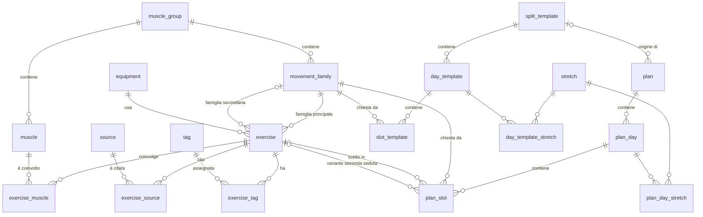

# Modello dati — Fase 1

| Campo | Valore |
| --- | --- |
| Stato | Bozza v0.2, in revisione |
| Data | 2026-10-28 |
| Riferimenti | Specifica fase 1; ADR 0003, 0005, 0006, 0013, 0014 |
| Modifiche v0.2 | Tabelle `tag` ed `exercise_tag` al posto di `exercise.neck` e `neck_note`; preferenze versione 2 con personalizzazioni di muscoli ed etichette |

## 1. Principi

1. **Due identificatori per le entità del catalogo.** Una chiave tecnica `id INTEGER` (chiave primaria, usata nelle relazioni) e un `code TEXT UNIQUE` stabile e leggibile (es. `chest-press-incline`), usato da seed, esportazione e importazione e dai test di riferimento. L'`id` può cambiare tra un'istanza e l'altra, il `code` no.
2. **Vincoli nel database dove possibile, nel dominio dove servono più tabelle.** Vincoli su una sola riga (valori ammessi, minimo < massimo) sono `CHECK`; vincoli che attraversano tabelle (es. "l'esercizio di uno slot deve appartenere alla famiglia dello slot") sono validati nel dominio e verificati dai test.
3. **Nessun dato derivato salvato.** Volumi, punteggi, stati delle fasce e durate si calcolano sempre (ADR 0007).
4. **Le schede sono indipendenti dai preset** (ADR 0006): la creazione copia la struttura dello split.
5. **Le cancellazioni non rompono mai una scheda.** Ciò che è usato da una scheda si disattiva, non si elimina.
6. **Valori enumerati come testo** con `CHECK` (es. `effect IN ('none','bonus','penalty','exclude')`), leggibili nel file SQLite e nell'esportazione.
7. **Date e ore in UTC**, formato ISO 8601.
8. **Il catalogo dà i valori predefiniti, la scheda salva solo le differenze** (ADR 0014). Valore effettivo = personalizzazione della scheda se esiste, altrimenti valore del catalogo.

## 2. Diagramma



## 3. Tabelle del catalogo

### 3.1 `muscle_group`

| Colonna | Tipo | Vincoli | Note |
| --- | --- | --- | --- |
| `id` | INTEGER | PK | |
| `code` | TEXT | UNIQUE, NOT NULL | `chest`, `shoulders`, `triceps`, `back`, `biceps`, `forearms`, `legs`, `core` |
| `name` | TEXT | NOT NULL | Nome in italiano |
| `sort_order` | INTEGER | NOT NULL | Ordine di visualizzazione |

### 3.2 `muscle`

| Colonna | Tipo | Vincoli | Note |
| --- | --- | --- | --- |
| `id` | INTEGER | PK | |
| `code` | TEXT | UNIQUE, NOT NULL | Es. `chest-upper`, `delt-lateral`, `triceps-long` |
| `name` | TEXT | NOT NULL | Es. "Petto alto (fascio clavicolare)" |
| `short_name` | TEXT | NOT NULL | Per tabelle strette e PDF, es. "Petto alto" |
| `muscle_group_id` | INTEGER | FK → `muscle_group`, NOT NULL, ON DELETE RESTRICT | |
| `priority` | TEXT | NOT NULL, CHECK IN (`priority`, `standard`, `none`) | Prioritario, non prioritario, nessun obiettivo |
| `weekly_min` | REAL | NULL | Fascia obiettivo, serie frazionarie a settimana |
| `weekly_max` | REAL | NULL | |
| `notes` | TEXT | NULL | |
| `sort_order` | INTEGER | NOT NULL | |

`CHECK`: se `priority = 'none'` allora `weekly_min` e `weekly_max` sono NULL; altrimenti sono entrambi valorizzati, `0 <= weekly_min < weekly_max`.

### 3.3 `equipment`

| Colonna | Tipo | Vincoli | Note |
| --- | --- | --- | --- |
| `id` | INTEGER | PK | |
| `code` | TEXT | UNIQUE, NOT NULL | `machine`, `cable`, `free-weight`, `bodyweight` |
| `name` | TEXT | NOT NULL | Macchina, Cavi, Pesi liberi, Corpo libero |
| `sort_order` | INTEGER | NOT NULL | |

### 3.4 `movement_family`

| Colonna | Tipo | Vincoli | Note |
| --- | --- | --- | --- |
| `id` | INTEGER | PK | |
| `code` | TEXT | UNIQUE, NOT NULL | Es. `press-incline`, `fly-horizontal`, `pull-vertical` |
| `name` | TEXT | UNIQUE, NOT NULL | Es. "Spinta inclinata" |
| `description` | TEXT | NULL | Cosa accomuna gli esercizi, quando sceglierla |
| `muscle_group_id` | INTEGER | FK → `muscle_group`, NOT NULL, ON DELETE RESTRICT | Gruppo sotto cui compare nel catalogo |
| `sort_order` | INTEGER | NOT NULL | |

Il gruppo di un esercizio è il gruppo della sua famiglia principale: non si ripete sull'esercizio.

### 3.5 `exercise`

| Colonna | Tipo | Vincoli | Note |
| --- | --- | --- | --- |
| `id` | INTEGER | PK | |
| `code` | TEXT | UNIQUE, NOT NULL | Es. `chest-press-incline` |
| `name` | TEXT | UNIQUE, NOT NULL | |
| `primary_family_id` | INTEGER | FK → `movement_family`, NOT NULL, ON DELETE RESTRICT | |
| `secondary_family_id` | INTEGER | FK → `movement_family`, NULL, ON DELETE SET NULL | `CHECK (secondary_family_id <> primary_family_id)` |
| `family_rank` | INTEGER | NOT NULL, ≥ 1 | Ordine editoriale nella famiglia principale (1 = preferito dalla ricerca). Usato come criterio secondario del punteggio |
| `equipment_id` | INTEGER | FK → `equipment`, NOT NULL, ON DELETE RESTRICT | Attrezzo principale |
| `equipment_detail` | TEXT | NULL | Es. "L o Smith", "M o corpo libero" |
| `kind` | TEXT | NOT NULL, CHECK IN (`compound`, `isolation`) | Multiarticolare o isolamento. Serve a ripetizioni predefinite, recuperi e stima della durata. Campo nuovo rispetto all'Excel |
| `stretch` | TEXT | NOT NULL, CHECK IN (`high`, `medium`, `low`) | Allungamento |
| `stretch_note` | TEXT | NULL | Es. "dipende dalla macchina" |
| `confidence` | TEXT | NOT NULL, CHECK IN (`solid`, `limited`, `opinion`) | Confidenza delle fonti |
| `notes` | TEXT | NULL | Note della ricerca |
| `is_active` | INTEGER | NOT NULL, DEFAULT 1, CHECK IN (0, 1) | Disattivato = non proposto, resta nelle schede (US-05) |
| `created_at` | TEXT | NOT NULL | |
| `updated_at` | TEXT | NOT NULL | |

Indici: `primary_family_id`, `secondary_family_id`, `is_active`.

La compatibilità col collo non è più una colonna: è espressa da etichette (§ 3.9, ADR 0014).

### 3.6 `exercise_muscle`

| Colonna | Tipo | Vincoli | Note |
| --- | --- | --- | --- |
| `exercise_id` | INTEGER | FK → `exercise`, ON DELETE CASCADE | |
| `muscle_id` | INTEGER | FK → `muscle`, ON DELETE RESTRICT | |
| `level` | TEXT | NOT NULL, CHECK IN (`P`, `S`) | |
| `note` | TEXT | NULL | Es. "solo con i manubri", "solo nella camminata del contadino" |

Chiave primaria: (`exercise_id`, `muscle_id`). Indice su `muscle_id` per il filtro "allena il muscolo X".

I pesi dei livelli (P = 1, S = 0,5) non stanno qui ma in `app_setting` (§ 5): cambiarli non richiede migrazioni.

### 3.7 `source` ed `exercise_source`

`source`

| Colonna | Tipo | Vincoli | Note |
| --- | --- | --- | --- |
| `id` | INTEGER | PK | |
| `code` | TEXT | UNIQUE, NOT NULL | `src-01` … `src-48`, con la numerazione dell'Excel |
| `title` | TEXT | NOT NULL | |
| `kind` | TEXT | NOT NULL | Meta-analisi, studio EMG, opinione esperta… (testo libero) |
| `url` | TEXT | NULL | |
| `reliability` | TEXT | NULL | Alta, media-alta, media… |
| `used_for` | TEXT | NULL | |

`exercise_source`: (`exercise_id` FK CASCADE, `source_id` FK CASCADE), chiave primaria su entrambe.

### 3.8 `stretch` e `daily_routine_item`

Servono al PDF (US-30). In fase 1 si modificano tramite seed o importazione; l'interfaccia di modifica è rimandata (domanda aperta 3).

`stretch`: `id`, `code` UNIQUE, `name`, `targets` (cosa allunga), `instructions`, `dose`, `confidence`, `note` (es. l'accorgimento per il collo dell'Excel).

`day_template_stretch` e `plan_day_stretch`: (`day_template_id` o `plan_day_id` FK CASCADE, `stretch_id` FK RESTRICT, `position`), chiave primaria sulle prime due colonne. Alla creazione della scheda gli stretch del giorno dello split vengono copiati, come gli slot.

`daily_routine_item`: `id`, `block` CHECK IN (`neck`, `pelvis`), `position`, `name`, `dose`, `purpose`, `confidence`. È il mini-allenamento quotidiano, unico per tutte le schede.

### 3.9 `tag` ed `exercise_tag`

Etichette assegnabili agli esercizi, con effetto sul punteggio (ADR 0014).

`tag`

| Colonna | Tipo | Vincoli | Note |
| --- | --- | --- | --- |
| `id` | INTEGER | PK | |
| `code` | TEXT | UNIQUE, NOT NULL | Es. `neck-caution`, `neck-avoid`, `not-in-gym` |
| `name` | TEXT | UNIQUE, NOT NULL | Es. "Collo: attenzione" |
| `description` | TEXT | NULL | Quando assegnarla |
| `symbol` | TEXT | NOT NULL | Nome di un'icona da un insieme chiuso definito nel frontend (es. `warning`, `ban`, `star`, `info`). Il PDF usa la stessa icona in SVG |
| `color` | TEXT | NOT NULL, CHECK IN (`neutral`, `info`, `success`, `warning`, `danger`) | Colore semantico, tradotto in tinte dal tema |
| `effect` | TEXT | NOT NULL, CHECK IN (`none`, `bonus`, `penalty`, `exclude`) | Effetto predefinito sul punteggio |
| `points` | REAL | NOT NULL, DEFAULT 0, CHECK ≥ 0 | Intensità di bonus e penalità; ignorata per `none` ed `exclude` |
| `show_badge` | INTEGER | NOT NULL, DEFAULT 1, CHECK IN (0, 1) | Simbolo visibile accanto agli esercizi in catalogo, scheda e PDF |
| `sort_order` | INTEGER | NOT NULL | Ordine dei simboli quando un esercizio ne ha più di uno |
| `created_at`, `updated_at` | TEXT | NOT NULL | |

`CHECK`: se `effect IN ('bonus','penalty')` allora `points > 0`.

`exercise_tag`

| Colonna | Tipo | Vincoli | Note |
| --- | --- | --- | --- |
| `exercise_id` | INTEGER | FK → `exercise`, ON DELETE CASCADE | |
| `tag_id` | INTEGER | FK → `tag`, ON DELETE CASCADE | |
| `note` | TEXT | NULL | Nota di questa assegnazione, es. "OK se le spalle non salgono" |

Chiave primaria: (`exercise_id`, `tag_id`). Indice su `tag_id` per il filtro "con l'etichetta X".

Non c'è un campo `is_active` sulle etichette: per disattivarne l'effetto basta `effect = 'none'`, per nasconderla `show_badge = 0`.

## 4. Split e schede

### 4.1 `split_template`

| Colonna | Tipo | Vincoli | Note |
| --- | --- | --- | --- |
| `id` | INTEGER | PK | |
| `code` | TEXT | UNIQUE, NOT NULL | `ppl-3`, `ppl-6`, `ul-4`, `pplul-5`, `pp-4`, `fb-3` |
| `name` | TEXT | NOT NULL | |
| `description` | TEXT | NULL | |
| `is_builtin` | INTEGER | NOT NULL, CHECK IN (0, 1) | I preset della fase 1 sono `1`. In fase 2 gli split personalizzati avranno `0` |
| `sort_order` | INTEGER | NOT NULL | |

### 4.2 `day_template`

| Colonna | Tipo | Vincoli | Note |
| --- | --- | --- | --- |
| `id` | INTEGER | PK | |
| `split_id` | INTEGER | FK → `split_template`, ON DELETE CASCADE | |
| `code` | TEXT | NOT NULL | Es. `push`; UNIQUE (`split_id`, `code`) |
| `name` | TEXT | NOT NULL | |
| `position` | INTEGER | NOT NULL | UNIQUE (`split_id`, `position`) |
| `times_per_week` | INTEGER | NOT NULL, CHECK 1-3 | |

Un giorno che si ripete a settimane alterne non è rappresentabile con un intero: per questo il Full body è A, B, C una volta ciascuno, invece di A, B, A alternato (documento sui dati iniziali).

### 4.3 `slot_template`

| Colonna | Tipo | Vincoli | Note |
| --- | --- | --- | --- |
| `id` | INTEGER | PK | |
| `day_id` | INTEGER | FK → `day_template`, ON DELETE CASCADE | |
| `position` | INTEGER | NOT NULL | UNIQUE (`day_id`, `position`) |
| `family_id` | INTEGER | FK → `movement_family`, NOT NULL, ON DELETE RESTRICT | |
| `default_sets` | INTEGER | NOT NULL, CHECK 1-8 | |
| `rep_min` | INTEGER | NOT NULL, CHECK ≥ 1 | |
| `rep_max` | INTEGER | NOT NULL | `CHECK (rep_max >= rep_min)` |
| `is_optional` | INTEGER | NOT NULL, CHECK IN (0, 1) | Facoltativo: entra nella scheda ma non nel volume |
| `weekly_weight` | REAL | NOT NULL, DEFAULT 1, CHECK IN (0.5, 1) | 0,5 = a settimane alterne (scrollate e Y-raise nel Pull) |
| `note` | TEXT | NULL | |

### 4.4 `plan`

| Colonna | Tipo | Vincoli | Note |
| --- | --- | --- | --- |
| `id` | INTEGER | PK | |
| `name` | TEXT | NOT NULL | |
| `split_template_id` | INTEGER | FK → `split_template`, NULL, ON DELETE SET NULL | Solo origine; la scheda non ne dipende. NULL anche per le schede vuote (US-10 CA3) |
| `preferences` | TEXT (JSON) | NOT NULL | Schema in § 4.7 |
| `is_active` | INTEGER | NOT NULL, DEFAULT 0, CHECK IN (0, 1) | Indice UNIQUE parziale `WHERE is_active = 1`: una sola scheda attiva |
| `revision` | INTEGER | NOT NULL, DEFAULT 1 | Cresce di 1 a ogni modifica della scheda, dei suoi giorni o dei suoi slot. Serve al controllo di concorrenza tra dispositivi (documento sulle API, § 4) |
| `created_at` | TEXT | NOT NULL | |
| `updated_at` | TEXT | NOT NULL | |

### 4.5 `plan_day`

| Colonna | Tipo | Vincoli | Note |
| --- | --- | --- | --- |
| `id` | INTEGER | PK | |
| `plan_id` | INTEGER | FK → `plan`, ON DELETE CASCADE | |
| `name` | TEXT | NOT NULL | Copiato dal giorno dello split, rinominabile |
| `position` | INTEGER | NOT NULL | UNIQUE (`plan_id`, `position`) |
| `times_per_week` | INTEGER | NOT NULL, CHECK 1-3 | |

### 4.6 `plan_slot`

| Colonna | Tipo | Vincoli | Note |
| --- | --- | --- | --- |
| `id` | INTEGER | PK | |
| `plan_day_id` | INTEGER | FK → `plan_day`, ON DELETE CASCADE | |
| `position` | INTEGER | NOT NULL | UNIQUE (`plan_day_id`, `position`) |
| `family_id` | INTEGER | FK → `movement_family`, NOT NULL, ON DELETE RESTRICT | |
| `exercise_id` | INTEGER | FK → `exercise`, NULL, ON DELETE RESTRICT | NULL = slot vuoto, nessun candidato valido (US-12 CA2) |
| `second_exercise_id` | INTEGER | FK → `exercise`, NULL, ON DELETE RESTRICT | Variante per la seconda seduta (US-17) |
| `sets` | INTEGER | NOT NULL, CHECK 1-8 | |
| `rep_min` | INTEGER | NOT NULL, CHECK ≥ 1 | |
| `rep_max` | INTEGER | NOT NULL | `CHECK (rep_max >= rep_min)` |
| `is_optional` | INTEGER | NOT NULL, CHECK IN (0, 1) | |
| `weekly_weight` | REAL | NOT NULL, DEFAULT 1, CHECK IN (0.5, 1) | |
| `locked` | INTEGER | NOT NULL, DEFAULT 0, CHECK IN (0, 1) | Lucchetto (US-15) |
| `note` | TEXT | NULL | |

`family_id` è modificabile (US-16 CA5): cambiandolo, il servizio assegna in `exercise_id` il miglior candidato della nuova famiglia nella stessa transazione.

Il riordino (US-16 CA2) riscrive le `position` del giorno in una sola transazione. Per non violare il vincolo UNIQUE durante l'aggiornamento, le posizioni si spostano prima in un intervallo temporaneo (valori negativi) e poi ai valori finali.

### 4.7 Preferenze e personalizzazioni (`plan.preferences`)

```json
{
  "version": 2,
  "equipment_order": ["machine", "cable", "free-weight", "bodyweight"],
  "max_session_minutes": 75,
  "overrides": {
    "muscles": {
      "quads": { "priority": "standard", "weekly_min": 6, "weekly_max": 8 }
    },
    "tags": {
      "neck-caution": { "effect": "exclude" }
    }
  }
}
```

| Campo | Valori | Default |
| --- | --- | --- |
| `version` | Intero; cresce quando lo schema cambia, con conversione dei valori vecchi nel dominio | 2 |
| `equipment_order` | Permutazione dei `code` di `equipment` | Macchina, cavi, pesi liberi, corpo libero |
| `max_session_minutes` | Intero o `null` | 75 |
| `overrides.muscles` | Mappa `code` muscolo → oggetto con uno o più tra `priority`, `weekly_min`, `weekly_max` | vuota |
| `overrides.tags` | Mappa `code` etichetta → oggetto con uno o più tra `effect`, `points` | vuota |

**Regole delle personalizzazioni** (ADR 0014):

1. Si salvano solo i campi che differiscono dal catalogo. Se un valore personalizzato torna uguale a quello del catalogo, il servizio lo rimuove, così la scheda torna a seguire il catalogo.
2. Valore effettivo di ogni campo = personalizzazione se presente, altrimenti catalogo. La risoluzione è una funzione pura del dominio (`resolve_muscle`, `resolve_tag`), usata da volumi, punteggio e PDF.
3. Il ripristino ("torna al catalogo") rimuove la voce, per un campo o per l'intero muscolo o etichetta.
4. Validazione sui valori **effettivi**: per ogni muscolo, se la priorità è diversa da `none` la fascia deve esistere con `0 <= weekly_min < weekly_max`; se la priorità è `none` la fascia è ignorata. Per ogni etichetta con effetto `bonus` o `penalty`, `points > 0`.
5. Le chiavi sono `code`, non `id`: il JSON resta leggibile ed esportabile. Una chiave che non esiste più nel catalogo (muscolo o etichetta eliminati) viene ignorata in lettura e rimossa al salvataggio successivo.

Validato da un modello Pydantic nell'API e da una dataclass nel dominio. Si salva come JSON e non in tabelle perché è letto e scritto sempre per intero e non serve interrogarlo per contenuto.

**Conversione dalla versione 1** (nessun dato reale la usa, ma la regola resta come esempio di migrazione dello schema): `muscle_priority_overrides` diventa `overrides.muscles.<code>.priority`; `neck_caution_policy` `allow` diventa `overrides.tags.neck-caution.effect = "none"`, `exclude` diventa `"exclude"`, `penalize` non produce voci.

## 5. Impostazioni globali: `app_setting`

| Colonna | Tipo | Note |
| --- | --- | --- |
| `key` | TEXT PK | |
| `value` | TEXT (JSON) | |

| Chiave | Default | Uso |
| --- | --- | --- |
| `level_weights` | `{"P": 1.0, "S": 0.5}` | Volume frazionario |
| `session_cap` | `10` | Tetto di serie frazionarie per muscolo per seduta (US-20) |
| `score_weights` | vedi documento sull'algoritmo | Punteggio |
| `duration_params` | vedi documento sull'algoritmo | Stima della durata |
| `warmup_text` | testo del riscaldamento | PDF |
| `effort` | `{"rir": "0-2", "failure_last_set": true}` | PDF: RIR obiettivo delle serie allenanti; se `failure_last_set`, l'ultima serie degli esercizi a macchina o di isolamento è indicata "a cedimento" (documento di ricerca, Parametri 2) |

## 6. Regole di cancellazione

| Oggetto | Se usato | Se non usato |
| --- | --- | --- |
| Esercizio | Solo disattivazione (`is_active = 0`); l'eliminazione è rifiutata (RESTRICT da `plan_slot`) | Eliminazione; a cascata `exercise_muscle`, `exercise_source` ed `exercise_tag` |
| Etichetta | Eliminazione con conferma (US-08 CA3); a cascata `exercise_tag`; il servizio rimuove la chiave da `overrides.tags` di ogni scheda nella stessa transazione | Eliminazione |
| Famiglia | Rifiutata se ha esercizi con famiglia principale, o slot di split o schede; il messaggio elenca gli usi | Eliminazione; negli esercizi dove era secondaria diventa NULL |
| Muscolo | Rifiutata se coinvolto in un esercizio | Eliminazione; il servizio rimuove la chiave da `overrides.muscles` di ogni scheda |
| Gruppo muscolare, attrezzo | Rifiutata se usato | Eliminazione |
| Fonte | Eliminazione con rimozione dei collegamenti | Eliminazione |
| Split | Eliminazione possibile (solo split non predefiniti, fase 2); le schede nate da lui restano, con origine NULL | Eliminazione |
| Scheda | Eliminazione con conferma; a cascata giorni e slot | Eliminazione |

## 7. Invarianti e dove si verificano

| Invariante | Dove |
| --- | --- |
| Valori enumerati, minimo < massimo, serie 1-8 | `CHECK` nel database |
| Fascia presente se e solo se priorità diversa da "nessun obiettivo" | `CHECK` |
| Un esercizio ha almeno un muscolo P | Dominio (validazione al salvataggio, US-03 CA2) e test di validità dei dati |
| L'esercizio di uno slot appartiene alla famiglia dello slot (principale o secondaria) | Dominio, quando si assegna un esercizio |
| La variante della seconda seduta esiste solo se il giorno si ripete almeno 2 volte (ricontrollato quando cambiano le volte a settimana, US-21 CA3); può essere di qualunque famiglia ed è diversa dall'esercizio principale | Dominio |
| Una sola scheda attiva | Indice UNIQUE parziale |
| Ogni slot di ogni split predefinito ha almeno un candidato attivo | Test di validità dei dati |
| Le preferenze rispettano lo schema | Pydantic nell'API, dataclass nel dominio |
| Ogni muscolo con priorità effettiva diversa da `none` ha una fascia effettiva valida | Dominio, al salvataggio delle personalizzazioni e del catalogo (una modifica del catalogo che renderebbe invalida una scheda è rifiutata con l'elenco delle schede coinvolte) |
| Bonus e penalità effettivi hanno `points > 0` | `CHECK` sul catalogo, dominio sulle personalizzazioni |

## 8. Corrispondenza con l'Excel

| Excel | Modello |
| --- | --- |
| `gruppi` | `muscle_group` |
| `muscoli` (codici `PA`, `PM`…) | `muscle` con `code` leggibili (`chest-upper`…); priorità e fasce invariate |
| `attrezzi` (`M`, `C`, `L`, `CL`) | `equipment` |
| `livelli` | `app_setting.level_weights` |
| `fonti` | `source` |
| `esercizi` | `exercise`; si aggiungono famiglie, `family_rank`, `kind`; allungamento diviso in valore e nota; la colonna collo diventa etichette: "Attenzione" → `neck-caution`, "Evitare" → `neck-avoid`, "OK" → nessuna etichetta; il testo dopo il giudizio diventa la nota dell'assegnazione |
| `esercizio_muscolo` | `exercise_muscle` |
| `esercizio_alternativa` | Non migrata: sostituita dalle famiglie (ADR 0006); serve solo come riscontro per costruirle |
| `esercizio_fonte` | `exercise_source` |
| `giorni_tipo`, `giorno_esercizio`, `split` | `split_template`, `day_template`, `slot_template`; gli esercizi fissi diventano famiglie |
| `stretching`, `mini_allenamento` | `stretch` (con `day_template_stretch`), `daily_routine_item` |

## 9. Punti di estensione

| Fase | Aggiunta prevista | Impatto sul modello attuale |
| --- | --- | --- |
| 2 | Salvare una scheda come split personalizzato | Nessuno: si copiano giorni e slot della scheda in `split_template` con `is_builtin = 0` |
| 2 | Ribilanciamento | Nessuno: usa `locked`, famiglie, preferenze e personalizzazioni esistenti |
| 2 | Nuovi vincoli personali (attrezzi assenti, fastidi, preferiti) | Nessuno: sono etichette create dall'interfaccia |
| 2 | Guida integrata | Nuova tabella di sezioni di testo collegate a gruppi ed esercizi |
| 3 | Registrazione degli allenamenti | Nuove tabelle `workout_session` (scheda, giorno, data, note) e `set_log` (sessione, `plan_slot_id` NULL, esercizio, numero di serie, carico, ripetizioni, RIR). L'esercizio è salvato anche direttamente, così lo storico resta valido se lo slot cambia |
| 3 | Sostituzione "macchina occupata" | Si registra nel `set_log` con l'esercizio usato davvero, senza toccare la scheda |
| 4 | Mesocicli | Nuova tabella di settimane collegate a una scheda, con moltiplicatori di serie |

## 10. Domande aperte

1. Campo `personal_notes` sull'esercizio, separato dalle note della ricerca e delle etichette? (domanda aperta 3 della specifica)
2. Interfaccia per modificare stretching e mini-allenamento: fase 1 o fase 2? La bozza la rimanda alla fase 2.

Risolte nella v0.2: fasce personalizzabili per scheda (sì, insieme alla priorità; ADR 0014).
